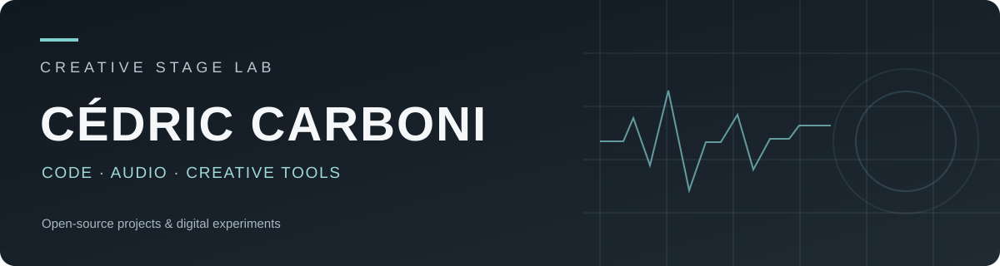

**Applications · audio · outils créatifs · expérimentations numériques**

### Projets publics

| Projet | Description |
| :--- | :--- |
| **[Chut!](https://github.com/cdriccarboni/chut)** | Débruitage vocal local pour macOS, Windows et Linux. |
| **[MISES!](https://github.com/cdriccarboni/mise-qr-case-finder)** | Application d'inventaire et de gestion de matériel par QR codes. |
| **[No-de](https://github.com/cdriccarboni/no-de-vibe-designer-pwa)** | Outils de création multimédia et de dispositifs interactifs. |
| **[SONARIS](https://github.com/cdriccarboni/SONARIS)** | Création et exploration sonore. |
| **[Pedal2Patch](https://github.com/cdriccarboni/pedal2patch)** | Application audio et création de patches. |
| **[Phablab Mobile Suite](https://github.com/cdriccarboni/phablab-mobile-suite)** | Utilitaires mobiles et expérimentations autour des capteurs. |

---

Quelques projets publics, du logiciel utilitaire aux outils pour la création. Cette page ne répertorie pas les dépôts privés.
