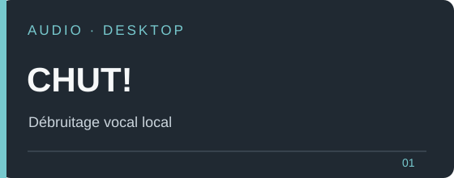
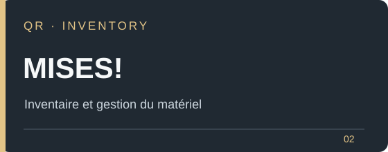
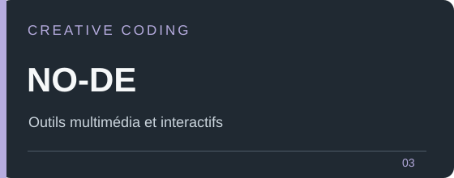
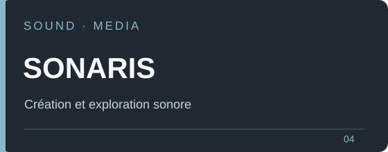
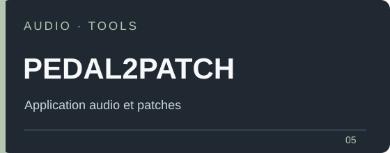
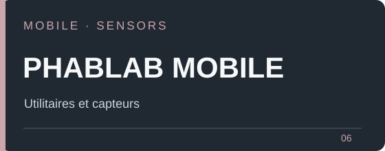

 

**Projets publics · applications · audio · outils créatifs**

 

## Projets sélectionnés

<table>
<tr>
<td width="50%" valign="top"> <a href="https://cdriccarboni.github.io/chut/">Site et téléchargements</a> · <a href="https://github.com/cdriccarboni/chut">Code source</a></td>
<td width="50%" valign="top"> <a href="https://github.com/cdriccarboni/mise-qr-case-finder">Voir le projet</a></td>
</tr>
<tr>
<td valign="top"> <a href="https://github.com/cdriccarboni/no-de-vibe-designer-pwa">Voir le projet</a></td>
<td valign="top"> <a href="https://github.com/cdriccarboni/SONARIS">Voir le projet</a></td>
</tr>
<tr>
<td valign="top"> <a href="https://github.com/cdriccarboni/pedal2patch">Voir le projet</a></td>
<td valign="top"> <a href="https://github.com/cdriccarboni/phablab-mobile-suite">Voir le projet</a></td>
</tr>
</table>

---

Une sélection de dépôts publics. Visuels typographiques conçus pour cette page : aucune photo générée et aucune information issue des dépôts privés.
